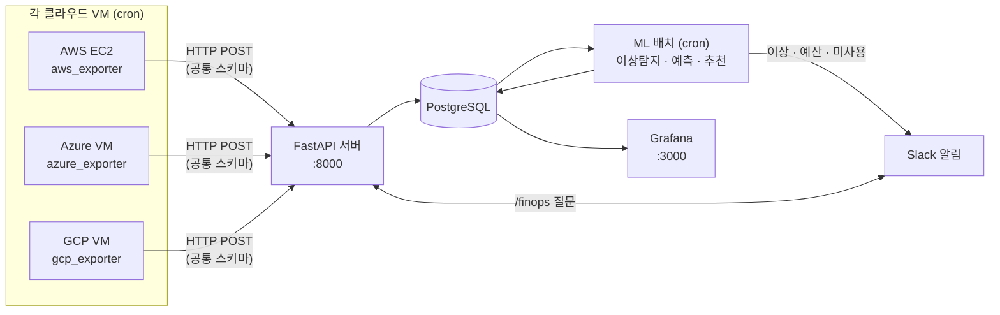

# CloudFit — 멀티클라우드 FinOps 모니터링

AWS · Azure · GCP에 흩어진 자원 사용률과 비용을 한 곳에 모아 보여주고, 이상 징후·낭비 자원·절감 기회를 자동으로 찾아 Slack으로 알려주는 시스템입니다.

클라우드를 여러 개 쓰면 비용을 확인할 때마다 콘솔을 따로 열어야 하고, 쓰지 않는 디스크나 갑자기 튄 사용량을 놓치기 쉽습니다. CloudFit은 세 클라우드의 데이터를 공통 형식으로 모아 하나의 대시보드와 챗봇으로 답합니다.

- 팀: A(AWS 담당) · B(Azure 담당) · C(GCP 담당)
- 2026 창의적 종합설계 경진대회 출품작 (충북대학교)

---

## 할 수 있는 것

| 기능 | 내용 | 코드 |
|------|------|------|
| 통합 수집 | 3개 클라우드의 CPU·메모리·디스크(5분마다)와 서비스별 비용(하루 한 번)을 공통 형식으로 수집 | `collectors/*_exporter.py` |
| 통합 대시보드 | 누적·일별 비용, 클라우드별 비교, 자원 사용률, 이상탐지 오버레이 (Grafana) | `dashboard/dashboard.json` |
| 이상탐지 | 지표별(CPU·메모리·디스크) 판정. 평균±3σ와 median/MAD 두 방식 | `ml/train.py`, `ml/anomaly_detector.py` |
| 비용 예측 | 클라우드별 향후 7일 비용 예측 (Prophet) | `ml/cost_forecast.py` |
| 비용 최적화 추천 | 저활용 인스턴스 다운사이즈, 가동률 높은 인스턴스의 약정 할인(RI/CUD) 전환 | `ml/recommend.py` |
| 미사용 리소스 탐지 | 연결 안 된 디스크·공인 IP. 연속 2회 발견될 때만 알림 | `collectors/*_unused_detector.py` |
| 예산 알림 | 클라우드별 월 예산 초과 시 Slack 알림 | `server/budget_alert.py` |
| Slack 챗봇 | `/finops` 명령으로 "이번 달 비용", "이상탐지 몇 건" 같은 질문에 답변 | `server/main.py` |

약정 할인율은 근사치가 아니라 각 클라우드의 가격 API로 실측한 값입니다 (AWS 39.23%, Azure 44.4%, GCP 37.0% — `decisions/0012`).

---

## 구조



- 수집기는 각 클라우드 VM에서 cron으로 돌고, 결과를 중앙 서버 API로 보냅니다.
- 서버(API · DB · Grafana)는 Docker Compose로 한 VM에서 운영합니다. 현재는 AWS EC2에서 ML 배치까지 함께 돕니다.
- 자원 지표와 비용은 같은 데이터를 다시 보내도 중복 저장되지 않고 최신 값으로 갱신됩니다 (`ON CONFLICT`).

### 수집·배치 주기

| 주기 | 작업 | 실행 위치 |
|------|------|-----------|
| 5분 | 자원 지표 수집 | 각 클라우드 VM |
| 매일 09:00 | 비용 수집 (`--costs`) | 각 클라우드 VM |
| 매일 09:15 | 미사용 리소스 탐지 | 각 클라우드 VM |
| 10분 | 이상탐지 | 서버 VM |
| 매일 09:30~09:50 | 비용 예측 → 예산 알림 → 최적화 추천 | 서버 VM |
| 매주 일 03:00 | 이상탐지 모델 학습 (최근 7일) | 서버 VM |

시각은 VM 시간대 기준입니다. 실제 crontab은 `runbook/crontab-reference.md`, 설치용 템플릿은 `scripts/cron/`에 있습니다.

---

## 시작하기

새 환경에 설치하는 전체 절차는 [`runbook/new-environment-setup.md`](runbook/new-environment-setup.md), 순서대로 칠 명령만 모은 것은 [`runbook/quick-commands.md`](runbook/quick-commands.md)에 있습니다. 아래는 요약입니다.

### 1. 설정 파일

```bash
cp .env.example .env
```

계정 · 리전 · 인스턴스처럼 환경마다 다른 값은 코드가 아니라 `.env`에서 읽습니다. 필수 값이 빠지면 어떤 키가 빠졌는지 알려주고 종료합니다. VM마다 필요한 섹션이 다르니 `.env.example`의 안내를 따르세요.

### 2. 서버 VM

```bash
bash scripts/install_server.sh          # 컨테이너 기동, 패키지 설치, 사전 점검 (cron은 미리보기만)
bash scripts/install_server.sh --apply  # 점검이 통과하면 ML 배치 cron까지 등록
```

API는 `http://<서버>:8000`, Grafana는 `http://<서버>:3000`에서 열립니다. 설치 스크립트는 Grafana 데이터소스와 대시보드를 자동으로 만듭니다 (`docker-compose.grafana.yml`). 이미 Grafana를 수동으로 설정한 서버라면 `--no-grafana-provision`을 붙이세요.

### 3. 수집 VM

```bash
bash scripts/install_collector.sh gcp          # aws | gcp | azure
bash scripts/install_collector.sh gcp --apply  # 점검이 통과하면 수집 cron 등록
```

메모리·디스크 지표는 클라우드 기본 지표가 아니라서 에이전트가 필요합니다 (AWS CloudWatch Agent, GCP Ops Agent, Azure Monitor Agent). 설치 방법은 runbook에 있습니다.

### 4. 확인

```bash
.venv/bin/python scripts/check_prereqs.py gcp           # 항목별 OK / WARN / FAIL (서버는 server)
.venv/bin/python collectors/gcp_exporter.py --dry-run   # 서버로 보내지 않고 수집 결과만 출력
curl "http://<서버>:8000/resources?cloud=GCP"
```

`.venv`는 설치 스크립트가 만든 가상환경입니다. 설치 스크립트 없이 직접 구성한 기존 운영 VM은 그 VM의 파이썬으로 실행합니다 (예: GCP VM은 `~/finops-env/bin/python3`).

---

## API

| 메서드 | 경로 | 설명 |
|--------|------|------|
| GET | `/health` | 상태 확인 |
| POST · GET | `/resources` | 자원 지표 저장 · 조회 (`?cloud=AWS`) |
| POST · GET | `/costs` | 비용 레코드 저장 · 조회 |
| POST · GET | `/unused-resources` | 미사용 리소스 저장 · 조회 |
| GET | `/anomalies` | 이상탐지 결과 |
| GET | `/recommendations` | 최적화 추천 결과 |
| GET | `/forecast` | 비용 예측 |
| GET | `/cost-by-owner` | 소유자 규칙(`allocation_rules`)별 비용 합계 |
| POST | `/ask` | 챗봇 질문 (JSON) |
| POST | `/slack/ask`, `/slack/interact` | Slack `/finops` 명령과 버튼 (서명 검증) |

---

## 데이터 스키마

세 클라우드의 필드명과 계산 방식을 하나로 맞췄습니다 (`decisions/0001`, `0002`). 전체 정의는 `db/schema.sql`에 있습니다.

| 테이블 | 내용 | 주기 |
|--------|------|------|
| `resource_metrics` | 인스턴스별 CPU · 메모리 · 디스크 구간 평균(%), 사양 | 5분 |
| `cost_records` | 클라우드 · 날짜 · 서비스별 비용(USD) | 하루 |
| `anomaly_results` | 지표별 이상 여부(3σ, MAD), 점수 | 10분 |
| `recommendations` | 다운사이즈 · 유지 · 약정 할인 전환 추천과 이유 | 하루 |
| `unused_resources` | 미사용 디스크 · IP | 하루 |
| `cost_forecast` | 향후 7일 예측값과 상·하한 | 하루 |
| `allocation_rules` | 인스턴스 → 소유자 매핑 (핵심 인프라는 다운사이즈 추천에서 제외) | 수동 |

---

## 폴더 구조

```
CloudFit/
├── collectors/        # 클라우드별 수집기, 미사용 탐지기, 공통 설정(cloud_config.py)
├── server/            # FastAPI 서버, 예산 알림, Slack 알림(notifier.py)
├── ml/                # 이상탐지 학습·판정, 비용 예측, 최적화 추천
├── db/                # PostgreSQL 스키마
├── dashboard/         # Grafana 대시보드
├── grafana/           # Grafana 자동 설정(데이터소스·대시보드)
├── scripts/           # 설치 스크립트, 사전 점검, cron 템플릿, 에이전트 설정
├── requirements/      # 클라우드별 최소 패키지 (루트 requirements.txt가 버전 기준)
├── tests/             # 단위 테스트
├── data/synthetic/    # 합성 데이터 생성·검증
├── runbook/           # 설치·운영 절차
├── decisions/         # 설계 결정 기록
├── incidents/         # 장애 기록
├── diary/             # 팀원별 작업 일지
└── evidence/          # 검증 캡처
```

---

## 기술 스택

| 영역 | 기술 |
|------|------|
| 언어 | Python 3.10+ (설치 스크립트 기준) |
| 서버 | FastAPI, SQLAlchemy(async), asyncpg |
| DB | PostgreSQL 15 |
| 시각화 | Grafana (자동 설정 시 13.1.8 고정) |
| ML | scikit-learn(Isolation Forest), Prophet, pandas |
| AWS | boto3 (CloudWatch, Cost Explorer, EC2, Price List) |
| Azure | azure-identity, azure-mgmt-monitor·compute·network·costmanagement, azure-monitor-query |
| GCP | google-cloud-monitoring·compute·bigquery(billing export), google-api-python-client |
| 운영 | Docker Compose, cron, Slack Webhook·슬래시 명령 |

---

## 테스트

```bash
python -m pytest tests -q
```

수집기 변환, 설정 로더, 비용 수집 플래그, 이상탐지, 사전 점검, cron 설치, Grafana 설정을 다룹니다. 클라우드 SDK가 설치돼 있어야 해당 테스트가 import됩니다.

---

## 알려진 한계

- **API 인증 없음**: 쓰기 API(`POST /resources` 등)에 인증이 없습니다. 팀 내부에서만 쓰는 전제이며, 외부 공개 전에는 API 키가 필요합니다 (`decisions/0015` 단계 3).
- **DB 포트 공개**: `docker-compose.yml`이 5432를 모든 인터페이스에 엽니다. 보안 그룹으로 막거나 `127.0.0.1`로 묶어야 합니다.
- **클라우드당 수집 VM 1대**: 수집기는 `.env`에 지정한 인스턴스 하나만 봅니다.
- **새 환경의 이상탐지는 며칠 뒤부터**: 첫 학습(클라우드당 20건 이상, 최근 7일) 전에는 모델 파일이 없어 이상탐지를 건너뜁니다. 비용 예측도 7일치 이상이 쌓여야 의미가 있습니다.
- **GCP 비용은 billing export 활성화 이후부터**: BigQuery 내보내기는 과거 데이터를 채워 주지 않습니다.

---

## 문서

- [`runbook/new-environment-setup.md`](runbook/new-environment-setup.md) — 새 환경 설치 가이드 (서버 → 수집 VM → 확인)
- [`runbook/quick-commands.md`](runbook/quick-commands.md) — 새 VM에서 칠 명령 순서
- [`runbook/crontab-reference.md`](runbook/crontab-reference.md) — 운영 VM crontab과 수집 주기
- [`decisions/`](decisions/) — 설계 결정 기록 (이상탐지 방식, 약정 할인율 실측, 소유자 규칙, 이식 계획 등)
- [`incidents/`](incidents/) — 장애 기록과 재현 절차
- `diary/`, `evidence/` — 작업 일지와 검증 캡처
